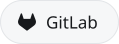
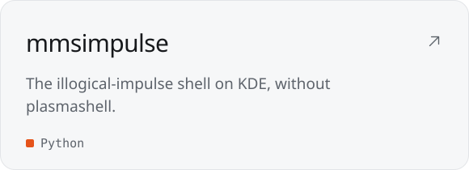
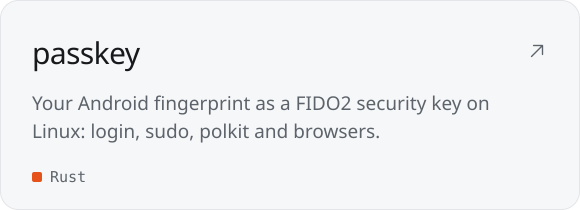
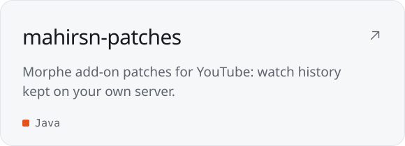
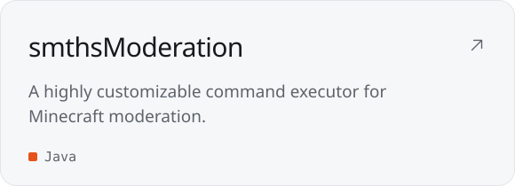

<!-- Images are built by scripts/build.py; edit the text there. -->

<a href="https://mahirsn.net"><picture><source media="(prefers-color-scheme: dark)" srcset="assets/header-dark.svg"></picture></a>

  <a href="https://mahirsn.net"><picture><source media="(prefers-color-scheme: dark)" srcset="assets/link-website-dark.svg"></picture></a>
  <a href="https://discord.gg/bir100sixteen"><picture><source media="(prefers-color-scheme: dark)" srcset="assets/link-discord-dark.svg"></picture></a>
  <a href="https://www.instagram.com/mahirsn.1"><picture><source media="(prefers-color-scheme: dark)" srcset="assets/link-instagram-dark.svg"></picture></a>
  <a href="https://www.youtube.com/@mahirsn"><picture><source media="(prefers-color-scheme: dark)" srcset="assets/link-youtube-dark.svg"></picture></a>
  <a href="https://www.reddit.com/user/mahirsn1/"><picture><source media="(prefers-color-scheme: dark)" srcset="assets/link-reddit-dark.svg"></picture></a>
  <a href="https://gitlab.com/mahirsn"><picture><source media="(prefers-color-scheme: dark)" srcset="assets/link-gitlab-dark.svg"></picture></a>

  <a href="https://github.com/mahirsn/mmsimpulse"><picture><source media="(prefers-color-scheme: dark)" srcset="assets/project-mmsimpulse-dark.svg"></picture></a>
  <a href="https://github.com/mahirsn/passkey"><picture><source media="(prefers-color-scheme: dark)" srcset="assets/project-passkey-dark.svg"></picture></a>
  <a href="https://github.com/mahirsn/mahirsn-patches"><picture><source media="(prefers-color-scheme: dark)" srcset="assets/project-mahirsn-patches-dark.svg"></picture></a>
  <a href="https://github.com/mahirsn/smthsModeration"><picture><source media="(prefers-color-scheme: dark)" srcset="assets/project-smthsModeration-dark.svg"></picture></a>

